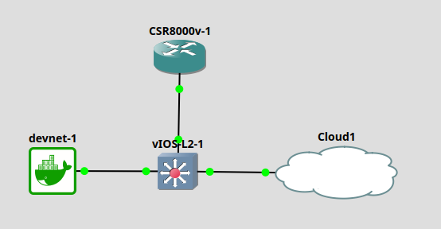

# 🚀 DevNet Journey — Marcelo Batista

> Jornada rumo à certificação Cisco DevNet Associate (200-901)
> com laboratório próprio (GNS3 + Docker) e registro por ETAPAS e FASES.

## 🧪 O laboratório

Topologia 100% própria, custo zero:

`devnet-1 (Docker/Ubuntu + arsenal Python) ↔ vIOS-L2 (switch) ↔ CSR8000v (IOS XE 17.6, RESTCONF+NETCONF) ↔ Cloud`

Container tudo-em-um construído com Dockerfile próprio (ver `lab/`):
Python 3, requests, netmiko, ncclient, napalm, ansible, nmap, tcpdump, git.

🗺️ O Mapa — 10 Etapas até a prova
✅ ETAPA 0 — Fundações do Lab (concluída)
 Fase 0.1 — Lab GNS3 + Docker montado do zero (topologia viva)
 Fase 0.2 — Git + GitHub + fluxo repo→push→pull→lab
 
🟡 ETAPA 1 — Python + APIs de Rede (em andamento)
 Fase 1.1 — curl → requests (trofeu.py: hostname via API)
 Fase 1.2 — Ferramenta RESTCONF completa (config × state × oper, throughput)
 Fase 1.3 — Ponte Rede → IA (ponte_ia.py: POST, Bearer, LLM) ← ATUAL
 Fase 1.4 — NETCONF 1º contato (lab_netconf.py: hostname em XML)

🟡 ETAPA 2 — Git Profissional
 Fase 2.1 — Branches e merge
 Fase 2.2 — Pull Requests e resolução de conflitos

🟡 ETAPA 3 — APIs REST a Fundo
 Fase 3.1 — API própria em Flask
 Fase 3.2 — POST/PUT/DELETE de verdade
 Fase 3.3 — Webhooks
 Fase 3.4 — Autenticação (API key, token, OAuth)

🟡 ETAPA 4 — NETCONF/YANG a Fundo
 Fase 4.1 — edit-config (mudar config via código)
 Fase 4.2 — Filtros XPath avançados
 Fase 4.3 — Datastores (running × startup × candidate)

🟡 ETAPA 5 — Docker e Deploy
 Fase 5.1 — Dockerfile/compose do zero
 Fase 5.2 — Rede entre containers
 Fase 5.3 — Deploy da própria API

🟡 ETAPA 6 — Automação Declarativa
 Fase 6.1 — Ansible playbooks
 Fase 6.2 — Inventários e roles

🟡 ETAPA 7 — Plataformas Cisco
 Fase 7.1 — Meraki (sandbox: org, rede, devices via API)
 Fase 7.2 — Catalyst Center
 Fase 7.3 — Webex

🟡 ETAPA 8 — Rede + Segurança da Automação
 Fase 8.1 — Fundamentos de rede para DevNet
 Fase 8.2 — APIs de segurança

🟡 ETAPA 9 — Reta Final
 Fase 9.1 — Simulados em blocos (30q / 68s)
 Fase 9.2 — Revisão dos 6 domínios
 Fase 9.3 — PROVA 200-901 🎯

## 📚 Sobre mim

30+ mercado de TI, 20+ anos docência, mestrado em computação, pós em
Data Science e IA Aplicada à Saúde.

## 🗂️ Estrutura

- `semana-XX/` — códigos e labs de cada semana
- `lab/` — Dockerfile, entrypoint e scripts do laboratório
- `docs/` — blueprint, rota de estudos, instalação do lab
- `diario-de-estudos.md` — registro de cada sessão
